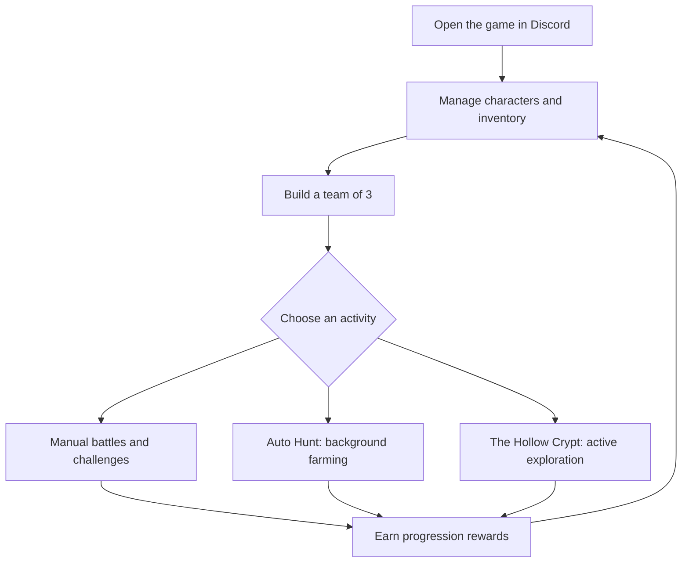

# THE HOLLOW REALMS

> A Discord-native, dark-fantasy RPG with whimsical cartoon energy and 16-bit pixel-art presentation.

**THE HOLLOW REALMS** is a turn-based RPG designed to be played inside Discord. Players collect characters, build a three-character team, equip weapons and armor, manage HP and Mana, fight through dungeons, and choose between active exploration and background farming.

This repository currently contains the game's **design documentation**. It is not a claim that the bot or every described system has already been implemented.

## At a glance

- **Platform:** Discord (slash commands, buttons, select menus, embeds and message updates).
- **Visual direction:** 16-bit pixel art; dark fantasy mixed with whimsical cartoon character design.
- **Character direction:** Adventure Time characters and their recognizable weapons/items for the current concept. No original player characters or invented franchise characters are in scope for now.
- **Combat:** Classic turn-based RPG; one player controls exactly three characters.
- **Resources:** HP and Mana. Mana regeneration is intentionally slow.
- **Equipment:** Weapon, Armor, Rune, Accessory 1 and Accessory 2.
- **Progression activities:** Auto Hunt and The Hollow Crypt serve different purposes.
- **Combat cards/decks:** No deck-building or deck-based combat is currently part of the design.

## Visual preview

The repository now includes SVG mockups for the Discord main menu, Character Card, collection gallery, turn-based battle screen, equipment inventory, Auto Hunt, Hollow Crypt map and 16-bit art direction.

See **[Visual Examples & Interface Mockups](docs/VISUAL_EXAMPLES.md)** for the full set of images and notes about placeholders, asset provenance and licensing.

## Documentation

| Document | What it covers |
|---|---|
| [Game Design](docs/GAME_DESIGN.md) | Vision, pillars, core loop and game modes |
| [Characters](docs/CHARACTERS.md) | Character roster direction, classes, stats and character progression |
| [Combat](docs/COMBAT.md) | Three-character turn-based battles, actions, Mana and battle state |
| [Weapons & Equipment](docs/EQUIPMENT_ITEMS.md) | Equipment slots, weapons, armor, runes, accessories and inventory |
| [Auto Hunt](docs/AUTO_HUNT.md) | Background farming sessions and rewards |
| [The Hollow Crypt](docs/HOLLOW_CRYPT.md) | Branching exploration run inspired by roguelite map choices |
| [Cards & Collection UI](docs/CARDS_COLLECTION.md) | Collection presentation and the distinction between UI cards and card-game mechanics |
| [Discord UX](docs/DISCORD_UX.md) | Commands, buttons, embeds, interaction flow and anti-spam rules |
| [Art Direction](docs/ART_DIRECTION.md) | Pixel-art style, UI language, image needs and visual consistency |
| [Technical Blueprint](docs/TECHNICAL_BLUEPRINT.md) | Suggested architecture, persistence, data model and reliability |
| [Roadmap & Open Decisions](docs/ROADMAP.md) | Suggested implementation order and items not finalized yet |

## Core gameplay loop

## Important design rules

1. **Discord is the game client.** Core play must work through Discord interactions; do not require a separate game client for ordinary play.
2. **Three characters per battle.** One player controls all three characters. This is not a three-human co-op party.
3. **Classic turn-based combat.** The player chooses each character's action, then enemies take their turn.
4. **Mana, not Energy.** There is no parallel Energy resource. Mana regeneration is slow.
5. **No deck combat.** Collection cards may be used as a presentation metaphor, but the battle system is not a deck-builder.
6. **Auto Hunt and Crypt are different modes.** Auto Hunt automates farming; the Crypt is an active, choice-driven run.
7. **No original characters for now.** Keep the current character concept limited to Adventure Time characters and existing franchise items until the direction changes.
8. **Do not present proposals as shipped features.** Many values, drop rates, character skills and progression details still need balancing and approval.

## Status and scope

This is a living design specification. The detailed documents label unconfirmed details as **proposal**, **example**, or **open decision**. Numeric examples are placeholders, not final balance values.

## References

- [Adventure Time — official Cartoon Network site](https://www.cartoonnetwork.com/)
- [Discord Developer Documentation](https://discord.com/developers/docs/intro)
- [Discord Components](https://discord.com/developers/docs/components/overview)
- [discord.py documentation](https://discordpy.readthedocs.io/)
- [Mortal Kombat Mobile — official game page](https://www.mortalkombat.com/)
- [Slay the Spire — official site](https://www.megacrit.com/)
- [GitHub repository](https://github.com/SaylerX505/sex4cards)
