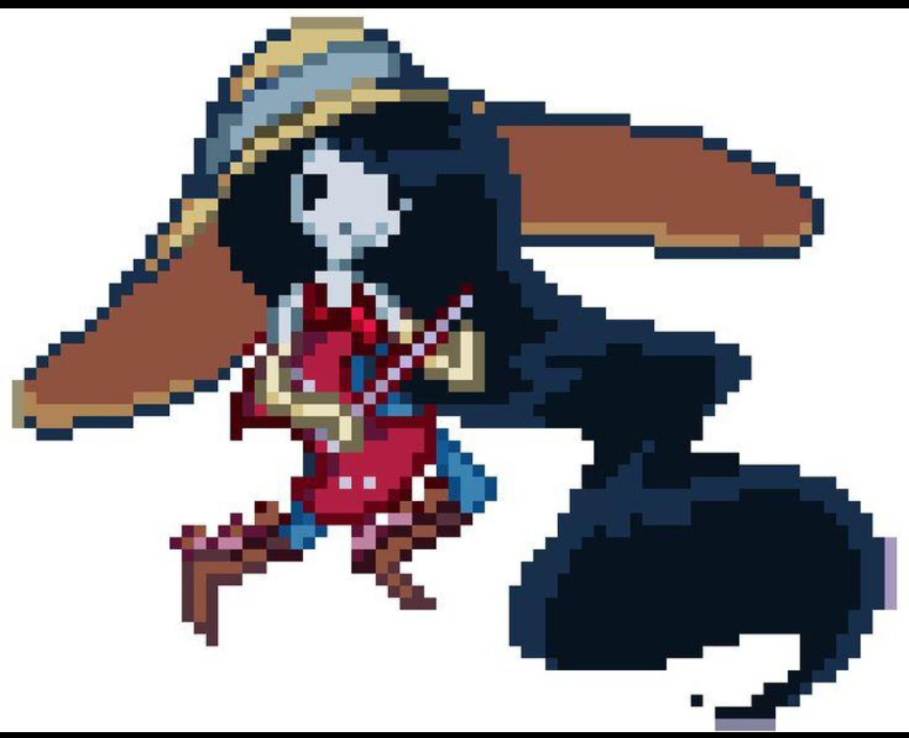
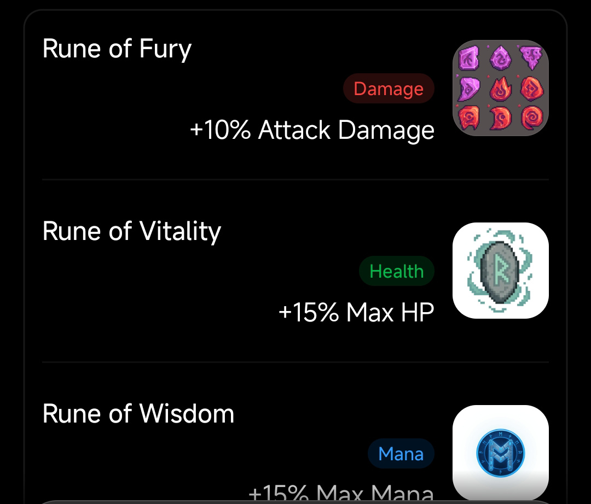
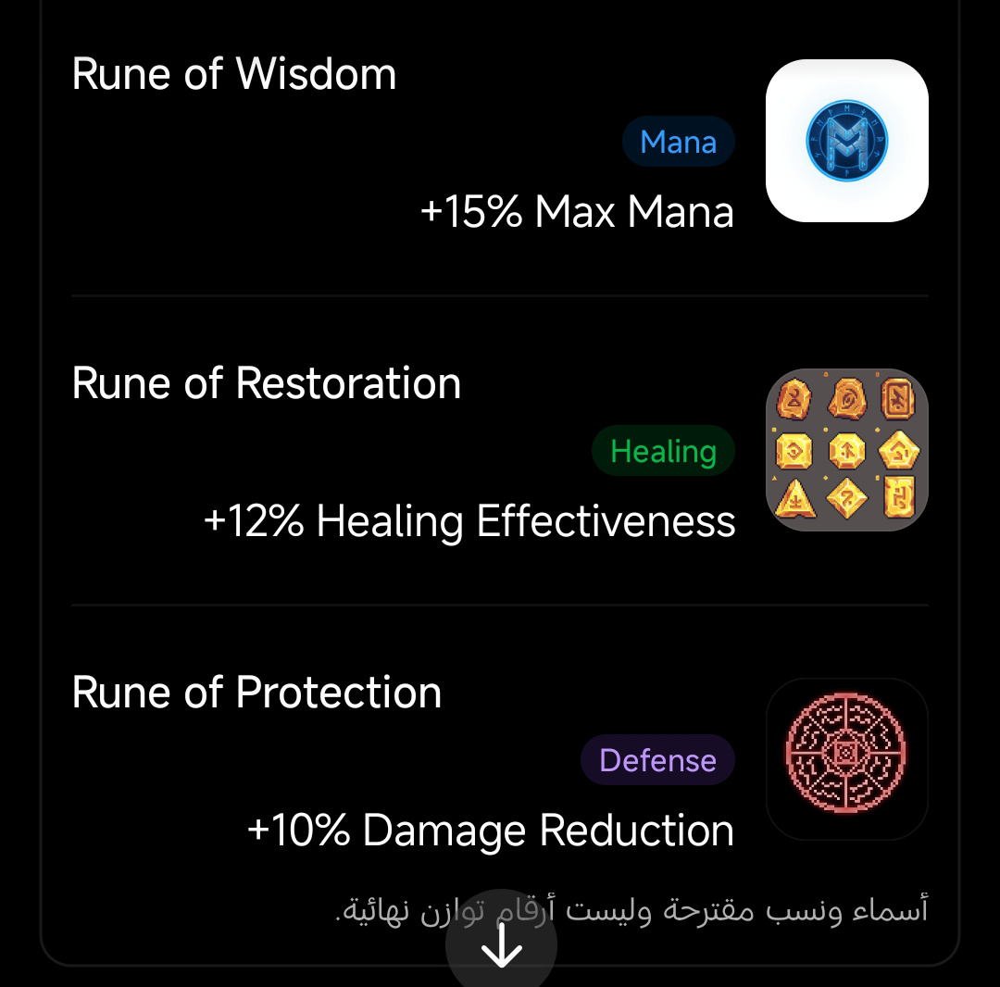

# THE HOLLOW REALMS

> A Discord-native, turn-based RPG with a dark-fantasy atmosphere, whimsical character energy and premium, high-detail pixel-art presentation.

THE HOLLOW REALMS is designed to be played inside Discord. Players collect Adventure Time characters, build a three-character team, equip source-backed franchise weapons and game-system Runes, manage HP and Mana, and choose between background farming and active exploration.

This repository is the living design archive. It documents the intended game; it does not claim that the bot or its systems have already been implemented.

## Project snapshot

| Area | Current direction |
|---|---|
| Platform | Discord slash commands, buttons, select menus, embeds and edited messages |
| Character content | Existing Adventure Time characters only for the current scope; no original characters |
| Visual identity | Premium, high-detail pixel art; flexible canvas size and pixel density |
| Battle | One player controls exactly three characters in classic turn-based combat |
| Resources | HP and Mana; Mana regeneration is intentionally slow |
| Equipment | Weapon, Armor, Rune, Accessory 1 and Accessory 2 |
| Runes | One passive Rune slot per character |
| Activities | Auto Hunt for background farming; The Hollow Crypt for active branching exploration |
| Card terminology | Collection/detail cards are UI panels, not decks or card-based combat |
| Realm progression | No Realm unlocking or Realm progression system |

## Visual references supplied for this project

These are the current reference images committed by the project owner. They guide the art treatment; they are not automatically approved final game assets or proof of usage rights.

### Character-art quality reference

The target is a carefully rendered, expressive pixel-art character with a readable silhouette, detailed costume and equipment, deliberate pixel clusters and strong shading. Do not copy this image's character or details as a new game character.

### Rune concept references

The reference sheet identifies five current Rune concepts: Fury, Vitality, Wisdom, Restoration and Protection. The shown names and percentages are proposals, not final balance values. Each Rune has its own detailed dossier in the item catalogue.

## Documentation map

Start with [the documentation index](docs/README.md). The main design documents cover:

| Document | Scope |
|---|---|
| [Game Design](docs/GAME_DESIGN.md) | Product vision, pillars and core loop |
| [Characters](docs/CHARACTERS.md) | Character roster scope, classes, stats and progression |
| [Combat](docs/COMBAT.md) | Three-character turn-based battles and Mana |
| [Weapons & Equipment](docs/EQUIPMENT_ITEMS.md) | Five equipment slots, item rules and inventory |
| [Item Catalogue](docs/items/README.md) | Individual item records, categories, status and open fields |
| [Auto Hunt](docs/AUTO_HUNT.md) | Background farming and reward boundaries |
| [The Hollow Crypt](docs/HOLLOW_CRYPT.md) | Branching exploration and temporary Run Relics |
| [Cards & Collection UI](docs/CARDS_COLLECTION.md) | Character/item presentation without deck combat |
| [Discord UX](docs/DISCORD_UX.md) | Commands, controls, embeds and low-spam interaction patterns |
| [Art Direction](docs/ART_DIRECTION.md) | Character, Rune, item and interface visual standards |
| [Visual Examples](docs/VISUAL_EXAMPLES.md) | Supplied references and historical mockups |
| [Asset Register](docs/ASSET_REGISTER.md) | Image provenance, status, locations and rights checklist |
| [Technical Blueprint](docs/TECHNICAL_BLUEPRINT.md) | Proposed architecture, persistence and reliability |
| [Roadmap](docs/ROADMAP.md) | Suggested implementation sequence and unresolved decisions |

## Core gameplay loop

1. Open the game through Discord.
2. Review the character collection, team, inventory and equipment.
3. Select exactly three characters for the team.
4. Improve the team through character progression, weapons, armor, Runes, accessories and skills.
5. Choose a manual battle, Auto Hunt session or Hollow Crypt run.
6. Resolve rewards and return to team management.

## Non-negotiable design boundaries

1. One player controls all three characters in a battle.
2. The initial battle flow is: first team member action, second team member action, third team member action, then the enemy phase.
3. Basic Attack is free. Skills generally consume Mana. There is no separate Energy resource.
4. Mana does not refill after every action; regeneration is deliberately slow.
5. Equipment has exactly five slots: Weapon, Armor, Rune, Accessory 1 and Accessory 2. There is no Headgear slot.
6. A Rune is passive equipment, not a selectable battle skill. Replacing a Rune returns the old Rune to inventory.
7. Ordinary Auto Hunt must not directly award playable characters or weapons.
8. Auto Hunt and The Hollow Crypt are different activities.
9. No original characters or invented Adventure Time canon items are in scope for now.
10. No deck-building or Realm-unlocking system is part of the current design.

## Status discipline

Every catalogue entry and mechanic is labelled as confirmed direction, source-backed reference, proposal or open decision. Values shown in reference images are not final balance. Unknown item names, acquisition routes, rarity, stats and upgrade costs stay explicitly unknown until approved.

Adventure Time is protected intellectual property. A reference image or fan-maintained wiki is not a licence. Public or commercial release requires appropriate rights and asset-permission review.
