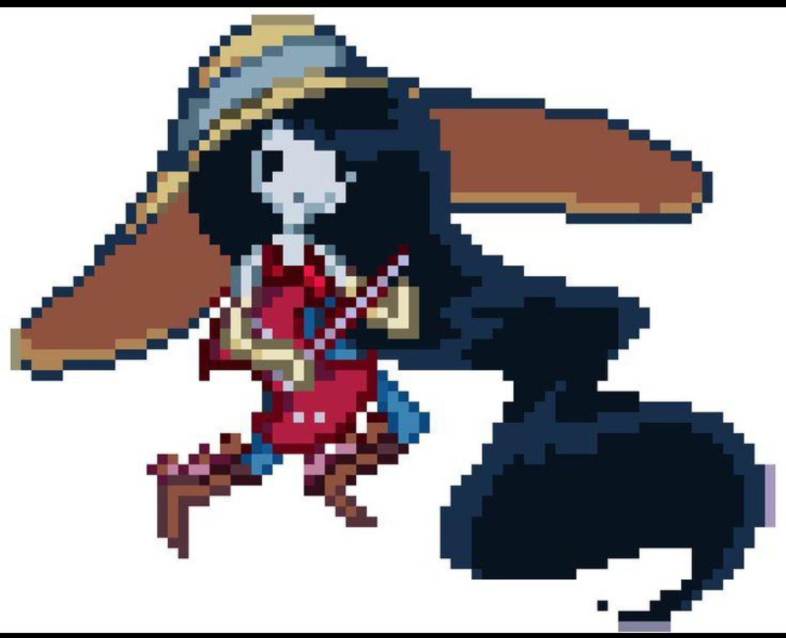
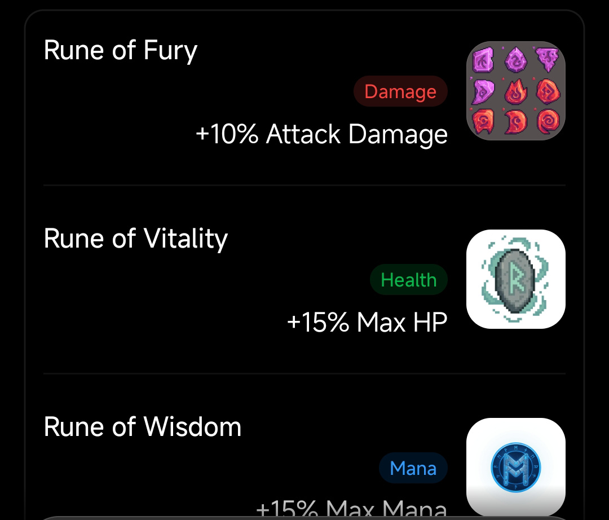
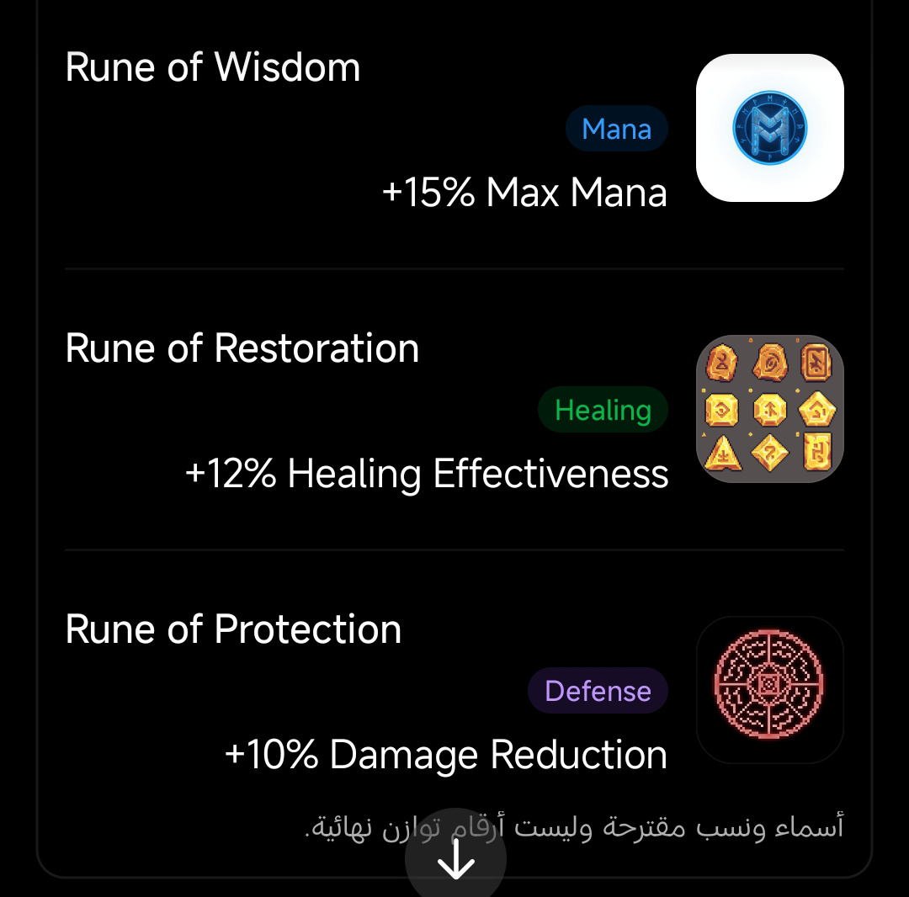

# Art Direction & Visual Style

## 1. Core vision

The target is premium, high-detail pixel-art illustration. Pixel art is the visual language, not a retro hardware constraint. Do not lock the work to 8-bit, 12-bit or 16-bit, a fixed palette size, one pixel scale or a tiny sprite canvas.

The finish should feel professionally art-directed: deliberate pixel clusters, layered values, expressive character acting, refined silhouettes, clean materials, coherent lighting and carefully designed equipment. The art should hold up in a large profile view and remain readable in a small Discord embed.

## 2. Owner-supplied visual references

### Character quality and rendering reference

Use this as a quality and rendering reference: expressive silhouette, visible costume construction, layered hair, controlled highlights and readable pixel clusters. It is not a new character specification and must not be copied as a new character or as a replacement for a source-backed Adventure Time design.

### Rune icon and presentation references

These images define the current visual study for five passive Rune concepts: Fury, Vitality, Wisdom, Restoration and Protection. Preserve each concept's distinct symbol language and color identity during the next design pass. The displayed percentages are proposed values, not final balance.

The provided screenshots are reference boards, not isolated production icon exports. Create clean individual transparent icons from approved source artwork during asset production; do not crop screenshot UI and call it final.

## 3. Character quality bar

Every character needs a deliberate design pass, not a generic sprite template.

Required:
- Strong, recognizable silhouette and character-specific proportions.
- Expressive face with readable eyes, brows and emotion.
- Layered hair, fur, skin and clothing shading.
- Costume construction: folds, seams, trims, fasteners and material variation where appropriate.
- Carefully rendered source-backed signature equipment.
- Coherent light direction, intentional highlights and controlled shadow shapes.
- Enough detail for portrait, collection view and battle crop without losing identity.

Do not:
- Enforce a universal 32×32, 64×64, 64×72 or other fixed canvas.
- Enlarge crude placeholder sprites and call the result finished art.
- Use flat rectangles as substitutes for anatomy, fabric or facial features.
- Force every character into identical body proportions or facial treatment.
- Add costume parts, weapons or accessories that are not part of the source-backed design.

## 4. Pixel technique and flexibility

- Choose canvas dimensions for the composition and use case.
- Use dense intentional clusters and selective pixel accents.
- Use material-specific value ramps for skin, fabric, metal, leather, hair and magic.
- Avoid noisy dithering, random texture and automatic blur.
- Use nearest-neighbor scaling for sprite exports where pixel scaling is intended.
- Keep the high-resolution master separate from portrait, embed and thumbnail exports.
- Do not define a global palette limit, bit depth, tile size or sprite frame size.

## 5. Character asset set

Each approved character should eventually receive:
1. Hero portrait / collection artwork.
2. Battle sprite with a readable action pose.
3. Portrait crop for compact embeds.
4. Optional expression set.
5. Animation frames only when required by the MVP.

All variants should derive from one approved design sheet. Do not redesign costume, face or weapon between output sizes.

## 6. Item quality bar

Items must receive the same art direction as characters.

- Weapons need a recognizable silhouette, clear construction, readable handle/guard/blade details and material highlights.
- Runes need distinct symbols and a consistent magical-material treatment; each must remain readable as a small icon.
- Armor needs clear material, coverage, construction and silhouette; no item names are approved yet.
- Accessories should only be illustrated after a real, source-backed Adventure Time object has been selected. Do not turn generic pendant/ring/watch silhouettes into canon items.
- Consumables and materials need distinct category silhouettes and concise visual hierarchy once their exact item identities are approved.

## 7. Palette and lighting

Use deep purple, near-black, crimson and antique gold as world/UI anchors. Preserve the recognizable color identity of each character and item. Use gold for rarity/reward emphasis rather than covering every asset in gold. The five Rune concepts have individual color directions documented in their dossiers.

## 8. Discord presentation

Produce intentional exports for:
- Large character/item detail view.
- Embed-sized portrait or icon.
- Thumbnail and selection-list use.

Do not shrink a detailed asset until its important features vanish. Design the crop for mobile Discord and both dark and light UI contexts.

## 9. Asset status

- Owner-supplied JPGs under assets/references are current internal design references.
- Earlier generated PNG concept sheets in assets are archived exploratory work, not the current character/item art target.
- SVGs in assets are UI/layout mockups, not screenshots of a completed bot.
- No final production character or item asset is claimed by this document.

See [Asset Register](ASSET_REGISTER.md) and [Visual Examples](VISUAL_EXAMPLES.md).

## 10. Source, licensing and provenance

Adventure Time characters, recognizable designs, branding and signature objects are protected franchise material. A reference or fan-maintained wiki is not a license. Public or commercial release requires appropriate rights.

For every production asset, record source URL, creator, permission/license, attribution terms, derivative rights, asset path and review status. Do not scrape or redistribute reference art without checking its terms.
