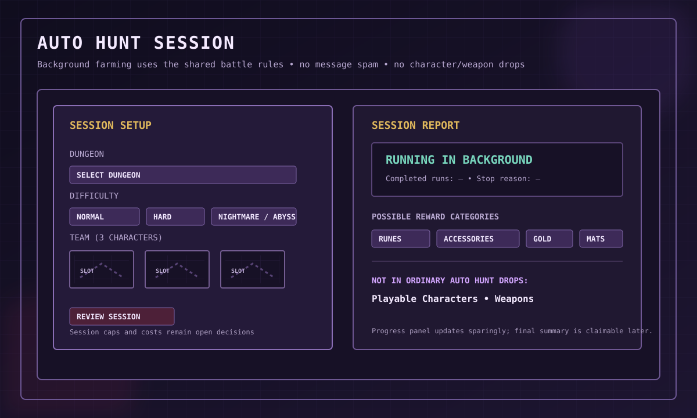

# Auto Hunt

## 1. Purpose

Auto Hunt is the game's background farming activity. The player selects a dungeon, difficulty and team of three characters, starts a session, and the bot resolves repeated encounters automatically.

Its purpose is efficient progression farming, not active map exploration.

## 2. Session setup

A session setup flow should let the player:
1. Select an available dungeon.
2. Select a difficulty.
3. Select a saved team or choose three characters.
4. Review expected risk and session rules.
5. Start the session.

One player controls the team of exactly three characters.

## 3. Automatic run behavior

Use the same battle rules as manual combat wherever possible: HP, Mana, stats, classes, skills, equipment, Runes, enemy abilities and statuses.

The Auto Hunt engine chooses valid actions according to an automated battle policy and advances encounters without requiring a click for every turn.

A session continues while configured continuation rules are satisfied and stops on defeat or another defined condition.

## 4. Reward catalogue

Potential reward categories:
- Runes.
- Accessories, once real source-backed item definitions are approved.
- Gold.
- Upgrade materials.
- Monster drops.
- Crafting materials.
- Essence or other progression resources.

Individual named items and category definitions are tracked in the [Item Catalogue](items/README.md).

**Hard reward boundary:** ordinary Auto Hunt does not directly award playable characters or weapons. Do not add either to its standard drop tables.

## 5. Difficulty and dungeon design

Normal, Hard, Nightmare and Abyss were discussed as candidate difficulty names; their final labels, scaling and availability remain open.

Difficulty should change encounter mechanics, not only enemy HP. Potential mechanics include dangerous formations, enemy skills, status effects, protection/support relationships and different elite/boss patterns. Poison, Bleed and Mana Drain are possible effects, not final definitions.

## 6. Progression over time

Auto Hunt level, run efficiency, loot bonuses and longer sessions are possible progression ideas, not finalized mechanics. Avoid adding currencies or upgrade tracks without a defined purpose.

## 7. Session limits and balance

Maximum duration, run count, entry costs, access requirements and cooldowns are open. No specific limit or cost has been approved. There is no Energy resource in the current design.

## 8. Background processing

Run Auto Hunt in a worker/background process rather than sending a Discord message for every encounter.

Recommended behavior:
- Save session state and every completed run.
- Send a concise start acknowledgement.
- Update one progress/status message at sensible intervals.
- Send a final summary when the session ends.
- Let the player inspect the result later.
- Resume safely after a bot restart.

## 9. Session state

Track session ID and owner, selected dungeon/difficulty/team, timestamps, progress, relevant team HP/Mana, reward totals, stop reason and claim/settlement status.

HP/Mana persistence between Auto Hunt encounters must be specified by session rules; do not copy Crypt persistence automatically.

## 10. Failure and fairness

Automated actions must follow the same legality rules as player actions. Never cast a skill without enough Mana or consume an item the player does not own. Use server-side randomness and transaction-safe, idempotent reward settlement.

## 11. Visual example

The SVG is a setup/report concept, not a live screenshot. It illustrates background processing and concise status reporting.
