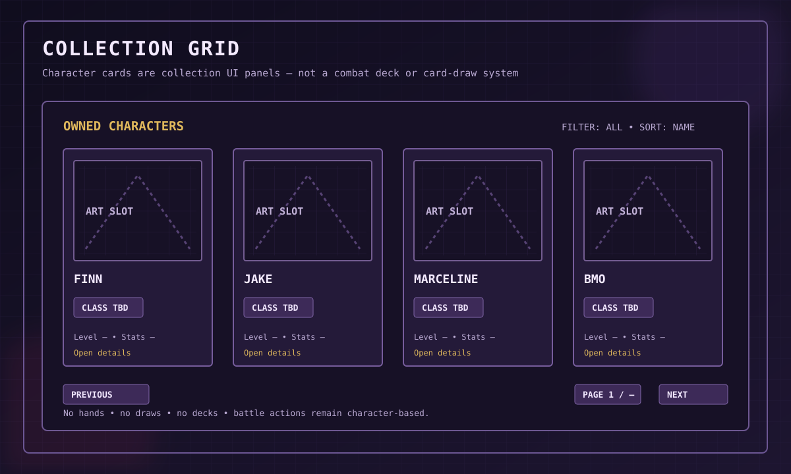

# Cards, Character Collection & Item Presentation

## 1. Terminology

Discord interfaces may use compact cards as presentation panels. They are not cards in a deck-building combat system.

- Character Card: UI view of one owned character.
- Item Card: UI view of one weapon, armor piece, Rune, accessory or consumable.
- Collection Card: compact tile in a roster or inventory gallery.
- Deck: not part of the current combat design.

No card draws, deck construction, card hands, card energy or deck-based battles.

## 2. Character collection

Players should be able to browse owned characters, inspect details, filter/sort, compare stats and select the three-person team. A locked-character index is optional and must be approved separately.

## 3. Character card content

A card may show portrait, display name, class, rarity (if approved), level, key stats, owned/equipped status and a detail action. Do not place unapproved final values into static artwork.

## 4. Item cards

An item card should show:
- Approved item artwork/icon.
- Exact item name and category.
- Equipment slot or use context.
- Rarity only if approved.
- Main stats and full effect description.
- Upgrade level, if that system is approved.
- Equipped-by or ownership indicator.
- Available actions such as inspect, compare, equip or consume.

For a Rune, clearly label its effect as passive. For a Crypt Run Relic, show that it expires at the end of the current run.

Every named item must link to its individual dossier in the [Item Catalogue](items/README.md). Category placeholder art is not enough to create a named item card.

## 5. Information hierarchy

1. Image/silhouette and item name.
2. Category and slot/use context.
3. Main effect or stat.
4. Secondary details and restrictions.
5. Action controls.

Keep the short version readable on mobile Discord. The full detail view can contain the full dossier summary.

## 6. Rarity presentation

Common/Rare/Epic/Legendary are candidate rarity labels only. If approved, communicate rarity using a consistent border, label or icon and do not rely on color alone.

## 7. Collection completion and social features

Achievements, collection completion rewards, favorites, wishlists, trading, PvP and co-op are not approved core systems. Keep the data model extensible without adding them to the MVP.

## 8. No deck combat

Combat remains character-based, turn-based RPG with Attack, Skill, Defend and Item choices.

## 9. Asset provenance

Track source, creator, permission/license, attribution and file path beside each character and item asset. Protected Adventure Time artwork cannot be redistributed solely because it appears on a wiki or public image URL.

## 10. Visual examples

See [Visual Examples](VISUAL_EXAMPLES.md) for the current character/Rune references and historical PNG studies.
