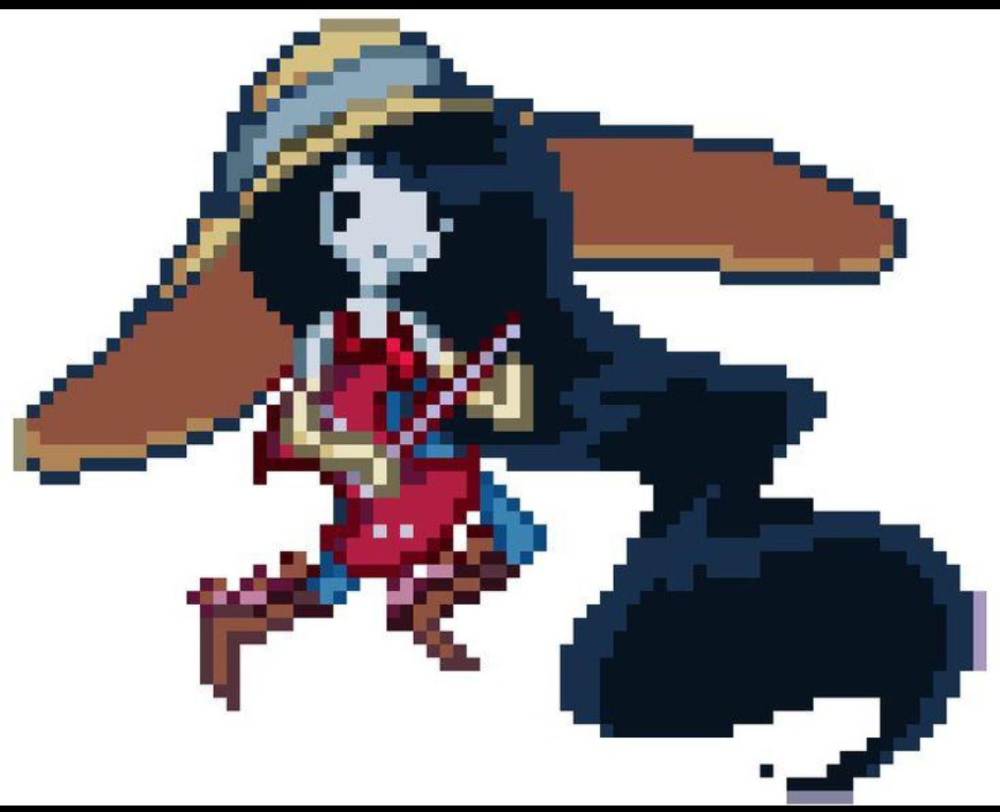

# Characters & Classes

## 1. Character concept

Characters are collectible units used to form the player's combat team. Each battle team contains exactly three characters, all controlled by one player.

Current direction:
- Existing Adventure Time characters only for the current scope.
- No original player characters or invented franchise characters for now.
- Premium, high-detail pixel-art illustration with variable resolution and no fixed bit-depth or sprite-size limit.
- Game classes and stats are mechanics layered onto the characters; they are not claims about official franchise canon.

## 2. Visual reference

This is the current character-quality reference. It guides rendering quality and detail only; it does not approve a character, costume, weapon or item for the game. See [Art Direction](ART_DIRECTION.md).

## 3. Candidate roster

Finn, Jake, Marceline, Princess Bubblegum, Ice King and BMO have been discussed as possible entries. This is a candidate list, not a finalized launch roster. Their final stats, rarity, skills, class assignments and availability remain open.

## 4. Character data model

A character definition should eventually contain:

| Field | Meaning |
|---|---|
| character_id | Stable internal identifier |
| display_name | Character display name |
| source_franchise | Source attribution |
| class_id | Assigned RPG class |
| rarity | Collection rarity, if approved |
| base_stats | Starting attributes |
| growth_curve | Level progression |
| passive_skill_id | Always-on passive, if used |
| active_skill_ids | Active skill definitions |
| ultimate_skill_id | Ultimate definition, if used |
| portrait_asset | Approved portrait asset path |
| battle_sprite_asset | Approved battle sprite path |
| signature_weapon_id | Optional source-backed weapon association |
| acquisition_sources | Approved acquisition routes |
| is_available | Whether currently obtainable |

Player ownership belongs to a player-character instance, not the global character definition.

## 5. Classes

The following six roles are a proposed starting set, not a finalized list:

| Class | Intended role | Typical strengths |
|---|---|---|
| Warrior | Reliable physical damage | ATK and balanced durability |
| Tank | Protect the team | HP, DEF and mitigation |
| Mage | Magical damage | Skill damage and Mana synergy |
| Assassin | Burst damage | Critical chance and single-target pressure |
| Healer | Restore health and sustain | Healing effectiveness |
| Ranger | Ranged/offensive utility | Consistent damage and accuracy |

A character should have one primary class in the initial version unless multi-class rules are explicitly approved.

## 6. Suggested kit structure

A simple proposed template:
- One passive ability.
- Two active skills.
- One ultimate ability.

This is not yet a confirmed rule for every character. Avoid large skill trees, long combo chains and overlapping resource meters.

## 7. Candidate statistics

| Stat | Meaning |
|---|---|
| HP | Current and maximum health |
| ATK | Attack strength |
| DEF | Defense / damage mitigation |
| SPD | Speed-related stat; impact on turn order is not decided |
| CRIT Rate | Critical-hit chance |
| CRIT DMG | Critical damage bonus |
| Accuracy | Chance for attacks/effects to connect |
| Resistance | Defense against selected effects or damage types |
| Max Mana | Maximum Mana capacity |

The UI should prioritize statistics relevant to the selected character and action.

## 8. Team order

The initial combat flow uses the displayed order of the three team slots. Speed may matter for other mechanics later, but it has not been approved as the player action-order rule.

## 9. Levels, rarity and progression

Level cap, XP curve, ascension, duplicate handling, skill-upgrade costs and final rarity tiers are open decisions. Common, Rare, Epic and Legendary were discussed only as possible labels. Do not implement a gacha or random character banner without an explicit decision.

## 10. Acquisition boundary

Ordinary Auto Hunt does not directly award playable characters or weapons. Character acquisition routes still need to be selected. Challenges, bosses, quests, exploration or events are ideas only.

## 11. Franchise and asset caution

Use source-backed Adventure Time characters and designs. Do not create replacement characters that imitate protected characters. Track source, creator, permission and asset location, and obtain rights review before public release.

## 12. Historical image studies

The old character roster PNG at assets/character-pixel-roster.png is retained as a historical placeholder only. It does not meet the current quality bar and must not be treated as a final roster sheet. The character-quality reference above is the current art-direction reference.
