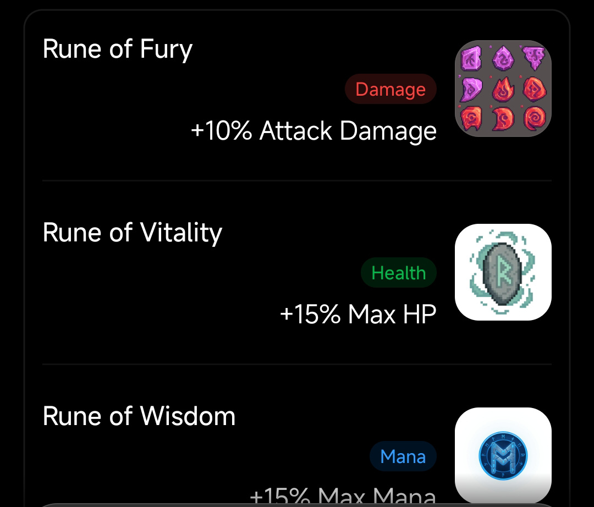
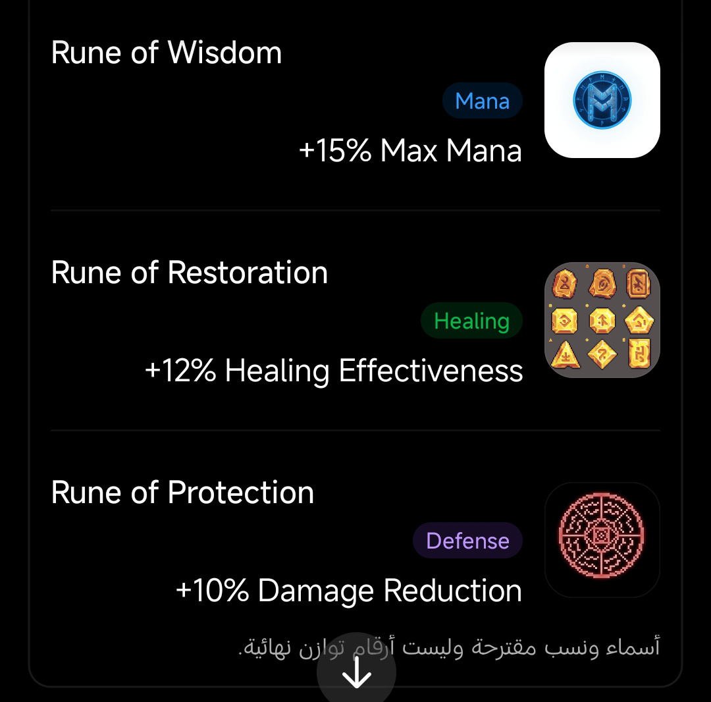

# Weapons, Equipment & Inventory

This document defines the five equipment slots and their shared rules. The [Item Catalogue](items/README.md) contains the individual item dossiers.

## 1. Equipment slots

Each character has exactly five equipment slots:

| Slot | Purpose | Current status |
|---|---|---|
| Weapon | Main weapon and weapon effects | Slot confirmed; named candidates documented separately |
| Armor | Defensive stats and possible defensive effects | Slot confirmed; exact armor items open |
| Rune | Passive stat/effect bonuses | Slot and passive role confirmed; five Rune concepts documented |
| Accessory 1 | Additional stats or passive effect | Slot confirmed; no canon item approved yet |
| Accessory 2 | Additional stats or passive effect | Slot confirmed; no canon item approved yet |

There is no Headgear slot.

## 2. Weapons

The current source-backed research list contains:
- Grass Sword
- Demon Blood Sword
- Ax Bass

Each weapon has a separate dossier covering its source identity, appearance, proposed game slot, unresolved mechanics and acquisition boundaries. These are candidate catalogue entries, not finalized loot, stats or balance.

Ordinary Auto Hunt must not directly award weapons. The acquisition route for each weapon is an open decision.

## 3. Armor

Armor occupies one slot and may eventually improve HP, DEF or resistance. No exact named armor item, armor set, class restriction, rarity or upgrade recipe has been approved. See [Armor Slot & Catalogue Status](items/armor/README.md).

## 4. Runes

Runes are passive equipment. Once equipped, a Rune applies its effect automatically; it is not selected from the battle action menu.

The owner-supplied reference images currently define five Rune concepts:

| Rune | Category | Reference effect | Status |
|---|---|---:|---|
| Rune of Fury | Damage | +10% Attack Damage | Proposal; value unbalanced |
| Rune of Vitality | Health | +15% Max HP | Proposal; value unbalanced |
| Rune of Wisdom | Mana | +15% Max Mana | Proposal; value unbalanced |
| Rune of Restoration | Healing | +12% Healing Effectiveness | Proposal; value unbalanced |
| Rune of Protection | Defense | +10% Damage Reduction | Proposal; value unbalanced |

Each Rune has a separate dossier in [the Rune catalogue](items/README.md#runes). The screenshots are visual references, not final individual icon exports.

Rune behavior:
- One Rune can be equipped per character.
- Replacing a Rune returns the old Rune to inventory; it is not consumed.
- Effects apply passively and should be reflected in effective character stats.
- Rarity, levels, upgrade cost, stacking, source/drop rates and exact effect formulas remain open.
- Rune sets are a possible future system, not an MVP commitment.

## 5. Accessories

Each character has two Accessory slots. No specific Adventure Time accessory has been approved for the catalogue yet. The old Pendant, Ring, Bracelet, Brooch, Charm, Buckle, Medallion and Watch shapes are generic explorations only and are archived as non-canon placeholders. They must not become item definitions or drop-table entries.

See [Accessory Catalogue Status](items/accessories/README.md).

## 6. Consumables, currency and materials

HP-restoring and Mana-restoring consumables have been discussed as possible battle/route resources. Gold, upgrade materials, crafting materials, monster drops and Essence are possible reward categories. Their individual names, quantities, effects, acquisition rules and spend sinks are not finalized.

Each category is documented in the [Item Catalogue](items/README.md).

## 7. Inventory requirements

Inventory should support:
- Category filters for weapons, armor, Runes, accessories, consumables and materials.
- Sorting by rarity, level, name or recently obtained.
- Discord-friendly pagination.
- Item detail views with full description and effects.
- Equip, unequip and compare actions.
- Clear equipped-by indicators.
- Safe handling of duplicate item instances.

## 8. Definitions versus owned instances

Keep static item definitions separate from player-owned instances. A definition describes the item's identity and base rules; an owned instance records its unique ID, owner, upgrade level and optional equipped-character reference.

Equip operations must validate ownership and slot compatibility in one transaction. Replacing gear returns the old owned instance to inventory; it must not delete it. Prevent double-selling, double-consuming or double-equipping after repeated Discord interactions.

## 9. Visual reference and archive

Earlier equipment PNGs are historical concept sheets only. Their generic accessory silhouettes and sample stats are not approved catalogue content. See [Asset Register](ASSET_REGISTER.md) for status and provenance.
