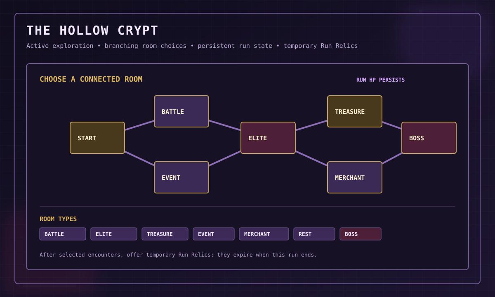

# The Hollow Crypt

## 1. Mode identity

The Hollow Crypt is an active, choice-driven exploration mode, separate from Auto Hunt.

- Auto Hunt: background farming and automated dungeon encounters.
- Hollow Crypt: active path choices, room risk, exploration and temporary run effects.

The concept draws inspiration from map exploration and persistent-team-health ideas in Mortal Kombat Mobile's Krypt, and branching routes and run-specific passive choices in Slay the Spire. The Crypt must use its own content, rules and assets.

## 2. Run setup

A proposed setup:
1. Choose a Crypt difficulty.
2. Choose a team of exactly three characters.
3. Start a new run.
4. Reveal the first available map choices.

Normal, Hard, Nightmare and Abyss are candidate names only.

## 3. Branching map

The Crypt is envisioned as a randomized branching map with hidden rooms revealed as the player explores. Potential room types:
- Battle
- Elite
- Treasure
- Event
- Merchant
- Shrine/Rest
- Boss

Room frequency, map length and reveal rules are open decisions.

## 4. Persistent team health

Team HP is intended to carry between battles within the same Crypt run, creating a route and recovery decision. Mana persistence, KO, revive, recovery rooms and consumable limits need explicit rules.

A character knocked out in the Crypt should not automatically become unavailable in every other game mode. Do not impose an excessive outside-run lockout.

## 5. Temporary Run Relics

Run Relics are temporary passive effects that exist only during one Crypt run.

- Equipment Rune: belongs to a character, remains in inventory when unequipped and uses the permanent Rune slot.
- Run Relic: belongs to the current run and expires when that run ends.

A possible milestone reward is a choice among several Run Relics after selected rooms. The offer count, names, effects, stacking and rarity remain open. See [Run Relic catalogue status](items/crypt/run-relics.md).

## 6. Run currency and merchant

A temporary run currency and merchant were proposed. Their name, acquisition, prices, inventory and permanent reward rules have not been decided.

## 7. Outcomes

Victory, defeat and escape are candidate outcomes. Partial rewards after defeat or escape were discussed but are not confirmed guarantees.

## 8. Difficulty and encounter variety

Difficulty should change enemy composition, mechanics and risk, not simply inflate HP. Elite enemies and bosses need recognizable patterns and clear status indicators.

## 9. Discord interaction design

Use one main map/status message, buttons or a select menu for connected paths, concise room/encounter views, clear team HP and a compact temporary-relic view. Prefer edited messages over repeated channel spam.

## 10. Persistence and safety

Persist the run after meaningful choices, room transitions, battle actions and reward settlement. Every room reward must be claimable only once. The run must survive bot restarts.

## 11. References

- [Mortal Kombat official site](https://www.mortalkombat.com/)
- [Slay the Spire official site](https://www.megacrit.com/)

These links explain design inspiration only; do not reproduce their maps, text, artwork, names or exact reward content.

## 12. Map mockup

The SVG demonstrates connected choices only. Map size, room frequencies, run length and reward tables remain open.
