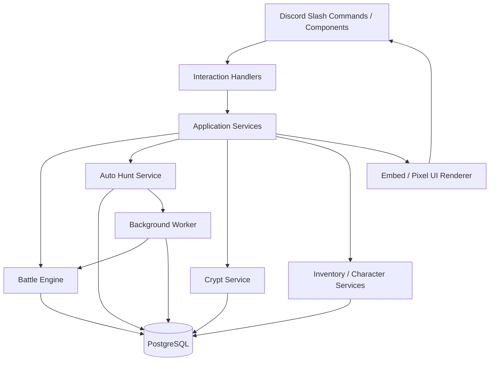

# Technical Blueprint

> Architecture proposal only. No implementation language, hosting provider or database has been confirmed by the user.

## 1. Goals

The technical foundation must support:
- Discord interactions as the primary client.
- Turn-based battles with persisted state.
- Background Auto Hunt sessions.
- Long-running Hollow Crypt runs.
- Character and item ownership.
- Safe reward settlement.
- Recovery after bot or worker restarts.
- Low-spam Discord message updates.

## 2. Suggested stack

A reasonable starting stack discussed:
- Python 3.12+.
- discord.py for Discord integration.
- PostgreSQL for durable game state.
- SQLAlchemy async and Alembic for data access/migrations.
- Redis later for queues, locks or short-lived coordination if needed.
- Pillow for image composition and pixel-art UI rendering.
- A background worker/scheduler for Auto Hunt and timed tasks.
- Docker for repeatable deployment.

These are recommendations, not confirmed implementation choices.

## 3. Logical architecture

Handlers should validate Discord input and call services. Game rules belong in domain services/engines, not inside button callback code.

## 4. Suggested domain modules

- discord/: commands, views, modals and interaction routing.
- characters/: definitions, ownership, progression and class rules.
- combat/: battle state, turn resolution, damage, status effects and AI.
- equipment/: item definitions, ownership, equip rules and upgrades.
- inventory/: item/material balances and pagination queries.
- dungeons/: dungeon definitions, encounters and difficulty modifiers.
- autohunt/: session lifecycle, worker and settlement.
- crypt/: map generation, rooms, run state, Run Relics and run rewards.
- economy/: Gold, currencies, purchases and transaction ledger.
- rendering/: embeds, icons, sprite composition and progress panels.
- persistence/: database models, repositories and migrations.

## 5. Suggested database entities

Potential tables (names are illustrative):
- users
- character_definitions
- user_characters
- class_definitions
- skill_definitions
- item_definitions
- user_item_instances
- equipment_loadouts
- rune_definitions
- dungeon_definitions
- enemy_definitions
- battles
- battle_actions
- battle_participants
- auto_hunt_sessions
- auto_hunt_runs
- crypt_runs
- crypt_map_nodes
- crypt_run_relics
- inventory_balances
- currency_transactions
- reward_claims
- asset_registry

Store static definitions separately from player-owned instances. A character definition describes Finn; a user-character record describes one player's owned copy and progression.

## 6. Persistence requirements

Never keep the only copy of battle/session state in process memory. Save:
- Current battle phase and round.
- Character HP/Mana and enemy HP/statuses.
- Accepted actions and action ordering.
- Auto Hunt session progress.
- Crypt map position and run-specific effects.
- Reward settlement state.

A restart should not reset a player's battle or silently discard a running session.

## 7. Transaction and idempotency rules

Every action that changes game state must be safe against duplicate Discord interactions:
- Use a unique interaction/action ID or state version.
- Validate expected current state.
- Apply the action and state transition in a database transaction.
- Record the result.
- Ensure rewards are claimed once.
- Use row-level locking or equivalent concurrency control for shared player state.

Never trust client-provided IDs without checking ownership and eligibility.

## 8. Randomness

Random rolls for combat and drops must be generated server-side. Do not let the client choose damage, drop outcomes or encounter results. Consider recording roll inputs/results for debugging and dispute resolution.

## 9. Background workers

Auto Hunt should be processed outside the Discord interaction callback. A worker should:
1. Claim an eligible session.
2. Load persisted state.
3. Resolve a bounded amount of work.
4. Save state and rewards transactionally.
5. Schedule/continue the next batch.
6. Update the user's progress message at a sensible cadence.

Worker leases and idempotent settlement prevent two workers from processing the same session simultaneously.

## 10. Testing

Required test areas:
- Battle turn order and action legality.
- Mana insufficiency and slow regeneration.
- Damage/healing calculations.
- Status effect timing and stacking.
- Team size validation (exactly three).
- Equipment slot compatibility and replacement behavior.
- Rune return-to-inventory behavior.
- Auto Hunt crash/restart and duplicate reward prevention.
- Crypt map validity and run persistence.
- Discord stale-button rejection.
- Inventory ownership and transaction safety.

## 11. Operational concerns

- Keep bot tokens and database credentials in environment secrets.
- Use structured logs with user IDs redacted or appropriately protected.
- Monitor worker lag and failed sessions.
- Back up PostgreSQL.
- Add migrations before schema changes.
- Provide admin-only diagnostics without exposing player secrets.
- Follow Discord rate limits and interaction response deadlines.

## 12. Implementation status

This file is a proposed blueprint, not evidence that any of the stack or modules exist in the repository yet.
