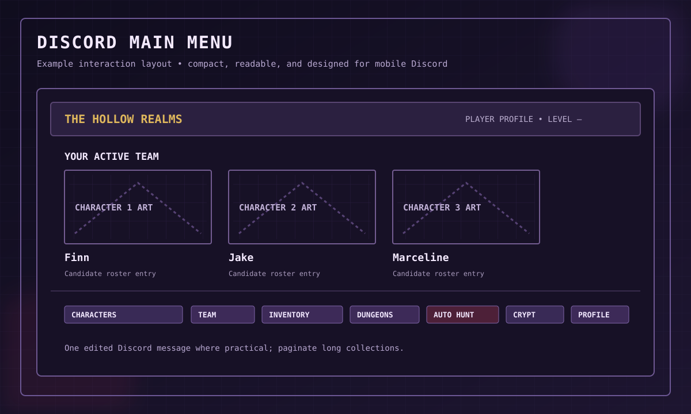
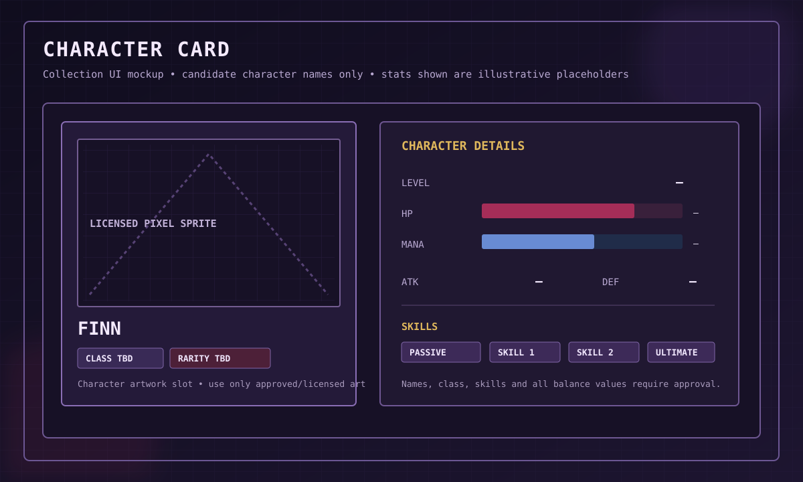
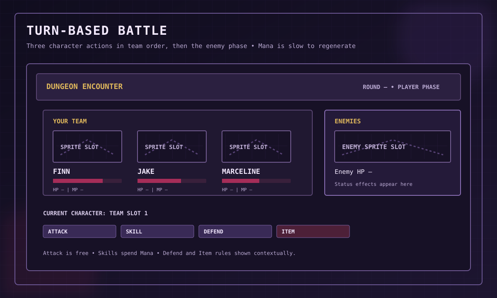
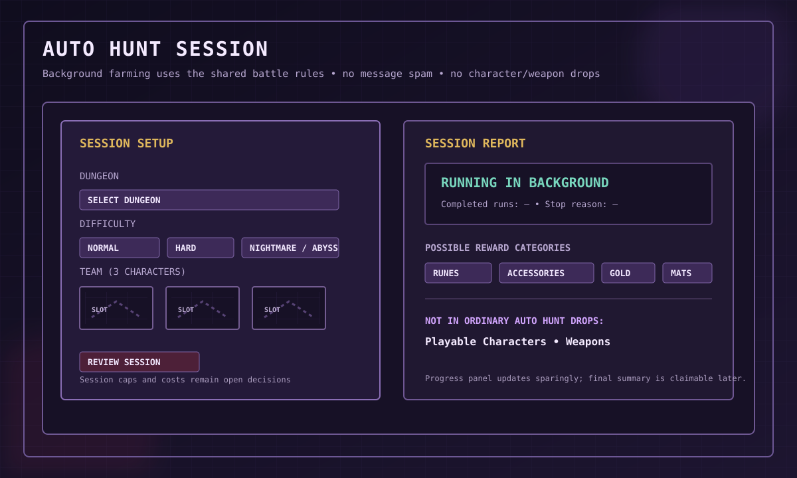
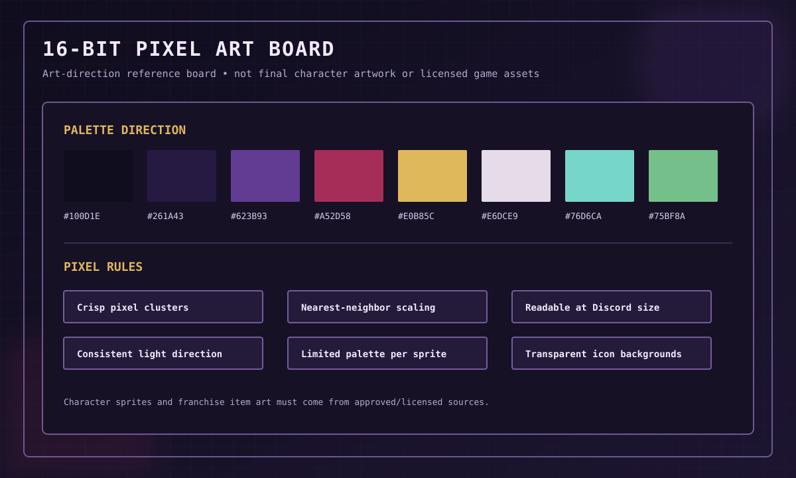

# Visual Examples & Interface Mockups

These mockups make the current design easier to picture before implementation. They are **design references**, not screenshots of a working bot and not final balance data.

> **Content boundary:** The current roster direction is Adventure Time characters only. No original characters, original franchise-style weapons, or invented lore are introduced here. Character images are neutral placeholders until approved/licensed pixel-art assets are available.

## 1. Overall visual direction

The game combines dark-fantasy atmosphere with whimsical cartoon energy. The approved visual medium is 16-bit pixel art. Use deep purple, near-black, crimson and gold as the main palette direction.

## 2. Discord main menu

A compact, editable message can surface the active team and route players to Characters, Team, Inventory, Dungeons, Auto Hunt, Crypt and Profile. Long lists should use pagination rather than oversized embeds.

## 3. Character detail card

The portrait area is reserved for approved Adventure Time pixel art. Finn is shown only as a candidate roster example; class, rarity, skill kit and numeric stats are intentionally marked as pending. The card is a presentation layer, not a combat card.

## 4. Collection gallery

Collection cards are browseable UI tiles. The design does **not** include a deck, hand, card draw or deck-based battle mechanic.

## 5. Battle screen

The player chooses Attack, Skill, Defend or Item for each of the three team slots in order. After all three actions, enemies act. Basic Attack is free; Mana is used for active skills and regenerates slowly after a full round. The HP bars and labels in the drawing are placeholders only.

## 6. Equipment and inventory

The five agreed slots are Weapon, Armor, Rune, Accessory 1 and Accessory 2. There is no Headgear slot. Runes are passive buffs and replacing one returns the previous Rune to inventory. The category symbols in this image are UI placeholders, not new named weapons or items.

## 7. Auto Hunt

Auto Hunt is background farming. It shares battle rules where practical, but does not ask the player to approve each action and should not send a message per run. Potential loot includes Runes, Accessories, Gold and materials. Ordinary Auto Hunt does not directly award playable characters or weapons.

## 8. The Hollow Crypt

The Crypt is an active branching exploration run. Example rooms include Battle, Elite, Treasure, Event, Merchant, Rest and Boss. Run HP persists according to the final run rules. Run Relics are temporary and expire at the end of the run; they are different from permanent equipment Runes.

## 9. Pixel-art style board

Use crisp clusters, deliberate outlines, consistent light direction and nearest-neighbor scaling. These mockups use vector shapes for interface planning; they are not a substitute for final pixel-art sprites.

## 10. External visual references

The links below are for discussion and style study only. They are **not approved game assets**, and the project must independently verify copyright, license, attribution and any Adventure Time permissions before bundling or publishing artwork.

- [Finn Pixel Sprite by LHTeam (itch.io)](https://lhteam.itch.io/finn-sprite) — fan-art pixel sprite reference; verify the asset terms and franchise rights before use.
- [Pixel Time: Jake, Finn & BMO (Dribbble)](https://dribbble.com/shots/2500293-Pixel-Time-8-Bit-Jake-Finn-Beemo) — fan-art style reference; not a cleared asset.
- [Lospec Pixel Art Tutorials](https://lospec.com/pixel-art-tutorials) — general pixel-art technique.
- [Aseprite](https://www.aseprite.org/) — sprite and animation workflow.

## 11. Asset pipeline

For each final art file, record:
- Asset ID and in-game use.
- Source/creator and source URL.
- License or written permission.
- Attribution requirements.
- Pixel dimensions, palette and animation frames.
- Local repository path and revision.

Do not treat an image search result, fan wiki image or public image URL as permission to redistribute an asset. A commercial or public release using Adventure Time characters, designs, logos or franchise items requires appropriate legal permission/licensing.
