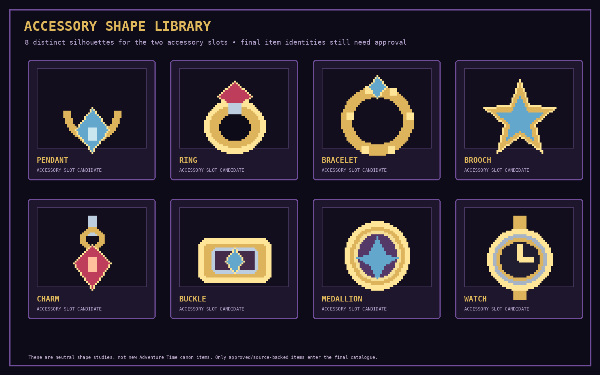

# Visual Examples & Pixel-Art Guide

This page contains raster PNG previews for THE HOLLOW REALMS. These images are committed to `docs/assets/` and render directly in GitHub Markdown.

> **Status:** These are higher-detail pixel-art concept studies and interface mockups, not final shipped assets or official Adventure Time artwork. They communicate the art direction. Final franchise art and named items require source research and appropriate rights for release.

## 1. Character sprite direction

The 64×72 base sprites have more pixel clusters, shading, facial features, hair, clothing and silhouette detail than the first rough sprite sheet. The candidate characters shown are Finn, Jake, Marceline, Princess Bubblegum, Ice King and BMO. The launch roster is not finalized; classes, skills, stats and rarity remain open.

## 2. Weapons and Runes

The weapon section illustrates existing Adventure Time references discussed so far, including the Grass Sword, Demon Blood Sword and Marceline's Bass Axe. These are concept studies, not a final item catalogue.

Rune symbols are game-system UI icons for passive buffs:
- **ATK:** increases attack/damage.
- **HP:** increases maximum Health.
- **Mana:** increases maximum Mana.
- **Heal:** improves healing effectiveness.
- **DEF:** provides defense or damage reduction.
- **Crit:** improves a critical statistic.

There is one permanent Rune slot per character. Runes activate automatically while equipped, are not battle skills, and return to inventory when replaced. Exact Rune names, values, rarity and upgrade rules remain to be balanced.

## 3. Accessories — visual variety

The eight shapes are **generic visual categories**, not newly invented Adventure Time canon items and not final item names. They explore the kind of visual variety that can fit the two Accessory slots:
- Pendant
- Ring
- Bracelet
- Brooch
- Charm
- Buckle
- Medallion
- Watch

The art team should later map these categories to actual, source-backed Adventure Time accessories/items. Do not add a generic shape to the canonical item database just because it appears in this style sheet.

## 4. Character collection cards

These are character collection cards for browsing and inspecting owned characters. They are not decks, hands, card draws or card-based battles. A final card should display the character portrait, approved class, level, rarity if used, key stats, passive/skills summary and a button to view details or add the character to the three-person team.

## 5. Battle and equipment interface

The battle view shows one player-controlled team of exactly three characters. The player chooses Attack, Skill, Defend or Item for each character in team order, then the enemies act. Basic Attack is free; active skills generally spend Mana, which regenerates slowly after a full round.

The five agreed equipment slots remain **Weapon, Armor, Rune, Accessory 1 and Accessory 2**. There is no Headgear slot. The UI now shows two different accessory silhouettes in the two Accessory slots.

## 6. The Hollow Crypt map

The Crypt is the active exploration mode. The player chooses connected rooms and manages risk throughout the run. Room categories discussed include Battle, Elite, Event, Treasure, Merchant, Rest and Boss. Exact map length, room distribution, Run Relic offer frequency and reward rules remain open.

Temporary Run Relics last only for the current Crypt run. They are separate from permanent equipment Runes.

## 7. Pixel-art production guidelines

- Use a larger base sprite canvas (64×72 for these studies) rather than relying on tiny 32×36 silhouettes.
- Keep pixel clusters deliberate, with clear outlines, face details, material shading and readable equipment shapes.
- Enlarge sprites using nearest-neighbor interpolation; never blur or anti-alias pixel art.
- Keep lighting direction and pixel density consistent across the roster.
- Use a controlled dark-fantasy palette: deep purple, near-black, crimson and gold, with character-specific colors.
- Export transparent PNGs for isolated sprites and icons.
- Create portrait, battle-sprite and thumbnail crops from the same approved source art.
- Make item silhouettes legible at small Discord attachment sizes.

## 8. References and licensing

These are research/style references, not automatically approved project assets:
- [Adventure Time — Cartoon Network](https://www.cartoonnetwork.com/)
- [Finn Pixel Sprite — LHTeam](https://lhteam.itch.io/finn-sprite) — fan-art pixel reference; check asset terms and separate franchise rights.
- [Adventure Time Fan Pixel Art — HelkPixel](https://helkpixel.art/projects/3dvqoo) — style reference only.
- [Grass Sword — fan-maintained reference](https://adventuretime.fandom.com/wiki/Grass_Sword)
- [Demon Blood Sword — fan-maintained reference](https://adventuretime.fandom.com/wiki/Demon_Blood_Sword)
- [Lospec Pixel Art Tutorials](https://lospec.com/pixel-art-tutorials)
- [Lospec Palette List](https://lospec.com/palette-list)
- [Aseprite](https://www.aseprite.org/)

A fan wiki or public image URL is not a license. Maintain an asset register with source, creator, license/permission, attribution and repository path. Public or commercial release using protected Adventure Time characters, designs, branding or recognizable franchise items requires appropriate rights.

## 9. Regeneration

All PNG concept sheets are generated by [`tools/generate_visual_assets.py`](../tools/generate_visual_assets.py). The [GitHub Actions workflow](../.github/workflows/generate-visual-assets.yml) rebuilds the PNGs when the generator changes on this branch.
