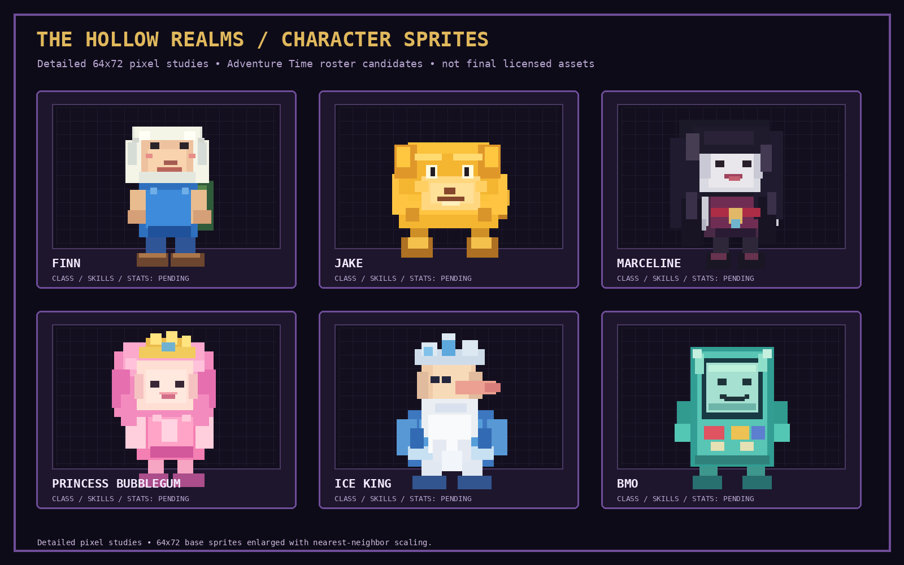
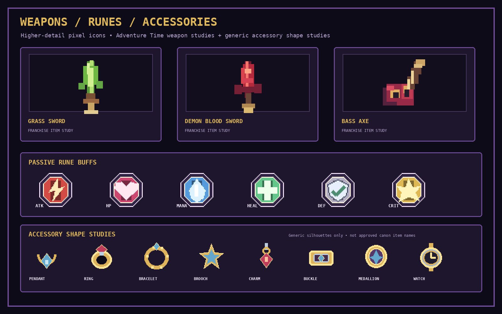
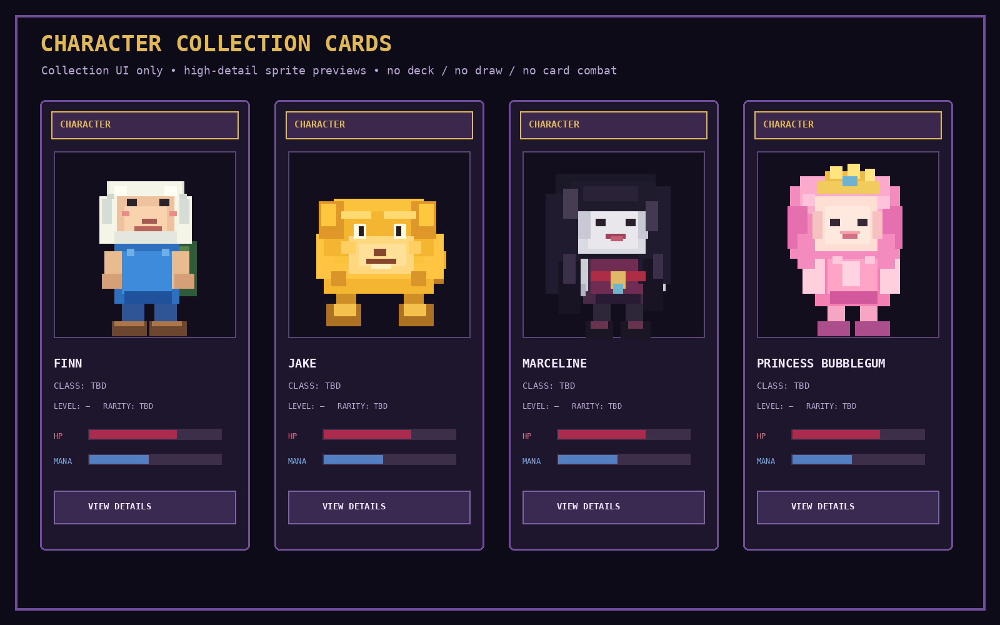
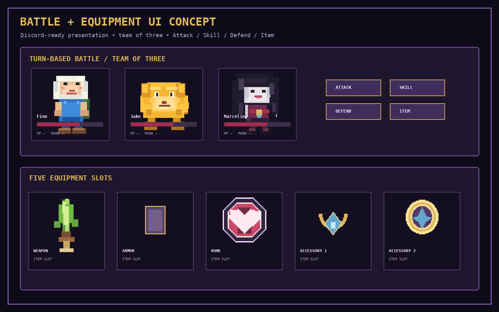
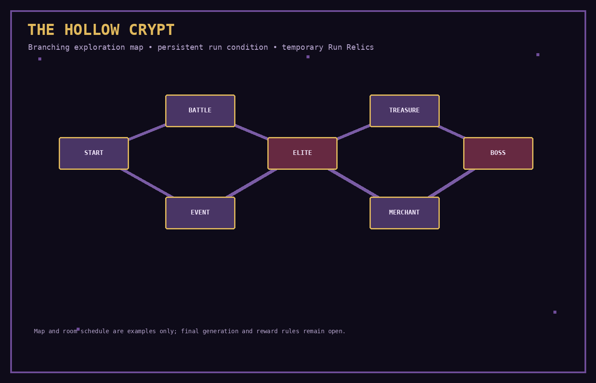

# Visual Examples & Pixel-Art Guide

This page contains the **raster PNG previews** for THE HOLLOW REALMS. These files are stored in `docs/assets/` and should display directly in GitHub's Markdown viewer.

> **Important:** These are early pixel-art concept studies and interface mockups, not final shipped assets or official Adventure Time artwork. They visualize the direction and selected recognizable references. Final character/item assets need a proper art pass and the appropriate rights for release.

## 1. Character sprite direction

The roster studies visualize the characters discussed so far: Finn, Jake, Marceline, Princess Bubblegum, Ice King and BMO. The launch roster is not yet finalized. The class labels, skills, stats and rarity still need to be researched, designed and approved; the image intentionally does not assign final gameplay values.

**Art rules:** 16-bit pixel language, crisp pixel clusters, readable silhouettes, limited palette, consistent sprite scale and nearest-neighbor enlargement. Aim for expressive, cute-creepy cartoon proportions while preserving the recognizable identity of the source character.

## 2. Weapons, equipment and Runes

The weapon concepts reference existing Adventure Time items discussed for the game, including the Grass Sword, Demon Blood Sword and Marceline's Bass Axe. These are visual studies, not an approved catalogue. Exact weapon naming, character compatibility and item acquisition remain open.

The Rune icons are **game-system UI symbols**, not invented franchise objects. They show the agreed passive buff families:

| Icon | Example effect family | Behavior |
|---|---|---|
| ATK | Damage / attack increase | Passive while equipped |
| HP | Maximum Health increase | Passive while equipped |
| Mana | Maximum Mana increase | Passive while equipped |
| Heal | Healing effectiveness increase | Passive while equipped |
| DEF | Damage reduction / defense | Passive while equipped |
| Crit | Critical damage or critical chance | Passive while equipped |

There is one Rune slot per character. Runes are permanent equipment and are not activated as battle skills. Replacing a Rune returns the previous Rune to inventory. Exact names, values, rarities and upgrades remain to be balanced.

The five equipment slots remain **Weapon, Armor, Rune, Accessory 1 and Accessory 2**. There is no Headgear slot.

## 3. Character collection cards

These are **collection cards**, used to browse and inspect owned characters. They are not a deck, a hand of cards or a card-draw combat system.

A final character card should display:
- Character pixel-art portrait.
- Name and approved class.
- Level and rarity, if the rarity system is approved.
- Key stats such as HP, ATK, DEF and Mana.
- A short passive/skill summary.
- An action to open full character details or select the character for the three-person team.

The current card values are illustrative placeholders. No character rarity, final stats or class assignment is implied by the image.

## 4. Battle and equipment interface

The battle concept shows one player-controlled team of exactly three characters. The player chooses **Attack, Skill, Defend or Item** for each character in team order, then the enemies act. Basic Attack is free; active skills generally use Mana. Mana regeneration is intentionally slow and happens after a full round.

The same image also shows the five equipment slots. It is a layout study, not a live Discord screenshot or a final component specification.

## 5. The Hollow Crypt map

The Crypt is the active exploration mode: the player chooses among connected rooms and manages risk over a run. Room categories discussed include Battle, Elite, Event, Treasure, Merchant, Rest and Boss. The exact number of branches, room distribution, map size, Run Relic frequency and reward rules are not finalized.

Temporary **Run Relics** belong only to the current Crypt run and disappear when it ends. They are separate from the permanent Rune equipment slot.

## 6. Pixel-art production checklist

- Keep sprites readable at small Discord attachment sizes.
- Use a consistent sprite canvas and pixel density.
- Enlarge pixel art with nearest-neighbor scaling.
- Keep the palette controlled: deep purple, near-black, crimson and gold accents, with character-specific colors.
- Use transparent PNGs for isolated sprites and icons.
- Create separate portrait, battle-sprite and small collection-thumbnail crops when the art pipeline is finalized.
- Keep item silhouettes recognizable at 32–64 px.
- Do not add original characters or original franchise-style weapons while the current content restriction remains in effect.

## 7. External reference links

These links are for research and style comparison only; they are not automatically approved game assets.

- [Adventure Time — Cartoon Network](https://www.cartoonnetwork.com/)
- [Grass Sword — fan-maintained reference](https://adventuretime.fandom.com/wiki/Grass_Sword)
- [Demon Blood Sword — fan-maintained reference](https://adventuretime.fandom.com/wiki/Demon_Blood_Sword)
- [Lospec Pixel Art Tutorials](https://lospec.com/pixel-art-tutorials)
- [Lospec Palette List](https://lospec.com/pixel-art-tutorials)
- [Aseprite](https://www.aseprite.org/)

A fan wiki or public image URL is not a license. Maintain an asset register with source, creator, license/permission, attribution and repository path. A public or commercial release using protected Adventure Time characters, designs, branding or recognizable franchise items requires the appropriate rights.

## 8. Source and regeneration

The concept PNGs are generated from [`tools/generate_visual_assets.py`](../tools/generate_visual_assets.py). The GitHub Actions workflow [`generate-visual-assets.yml`](../.github/workflows/generate-visual-assets.yml) rebuilds them when the generator changes on the documentation branch.

The earlier SVG interface diagrams remain in `docs/assets/` as supplementary layout studies. Use the PNG images above as the main visual previews.
